# brickdesk 视觉设计研究

调研对象：Folia（[chthollyphile/folia-major](https://github.com/chthollyphile/folia-major)，commit `4af2942`）
目标设备：TrimUI Brick Pro，1024×768，4:3，3.95 英寸，无触屏，仅手柄
产出：本文件、`prototype/v2/` 视觉稿、`docs/research/img/` 截图

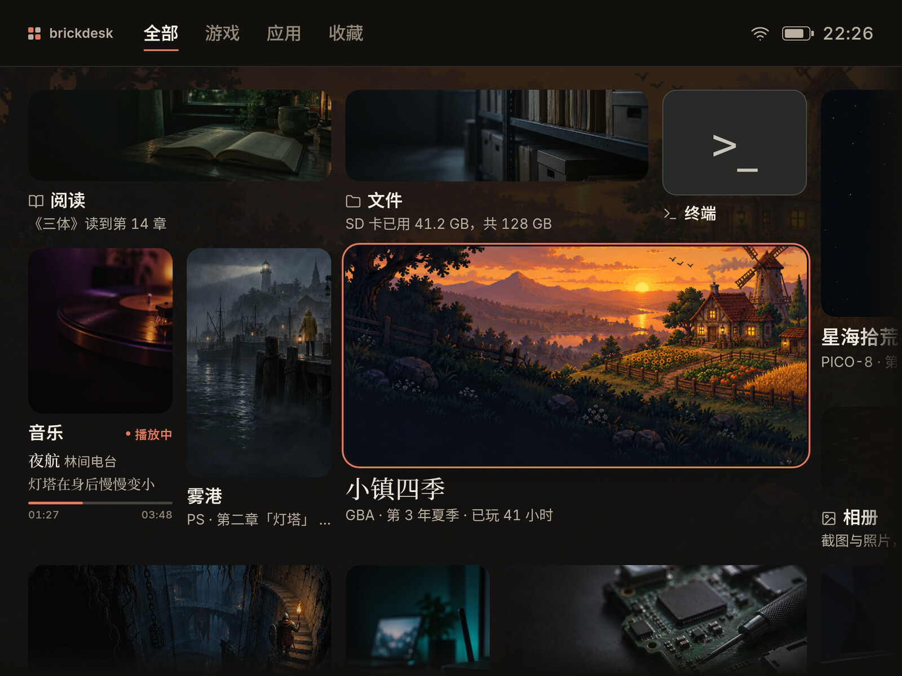

## 0. 结论

Folia 真正值得借鉴的不是某个具体样式，而是它的取舍顺序：**先让封面/歌词成为画面主体，再用极少的界面元素去托住它**。大面积留白、衬线标题、细线、单一强调色、只在焦点上出现的抬升，都是为这个顺序服务的。

brickdesk v2 采用「纸面书架」方向：

- 封面是一张张印在纸上的画，标题放在画外的纸面上，不再用底部黑色渐变把白字压在图上。
- 深色是暖墨黑，浅色是暖纸白；强调色用柿红，不用默认蓝，也不用霓虹渐变。
- 中文标题用衬线体，界面、设置、按钮用无衬线体；字号按 3.95 英寸屏重新排，不把桌面端的 12–14px 直接搬过来。
- 焦点用「纸色间隙 + 2px 柿红环 + 2px 抬升」表示，不做整行反色、不做纯白粗描边。
- 墙不再永远把焦点钉在屏幕中心；焦点接近视口边缘才平移，避免 4:3 屏上出现半排被切开的封面。
- 环境底色只用一张预先烘焙的封面图 + 平铺色纱，不做实时模糊、不做大面积渐变。
- 侧边栏、快捷面板、设置、提示栏、Toast、对话框都围绕同一套 token 和焦点规则重画。

## 1. Folia 的设计语言

### 1.1 我看了什么

- 克隆并阅读了 Folia 的首页与封面墙源码：`src/components/app/home/explore/`（Explore 首页、封面卡、动效、页面光）、`src/components/wall/wall.css`（封面墙与焦点）、`src/library/suites/bravais/bravaisHome.css`、`bravais.css`（Bravais 书脊与墙面）、`src/index.css`（字体与主题变量）。
- 在本地启动了 Folia 的 Vite dev server，用 agent-browser 以 1440×900 打开。因为没有连接流媒体账号，只能看到 Bravais 空墙；内容态使用仓库自带官方截图作对照。
- Folia 是 16:9 桌面应用，以下结论都按「它的设计意图」提炼，不把桌面尺寸直接当成 4:3 的答案。

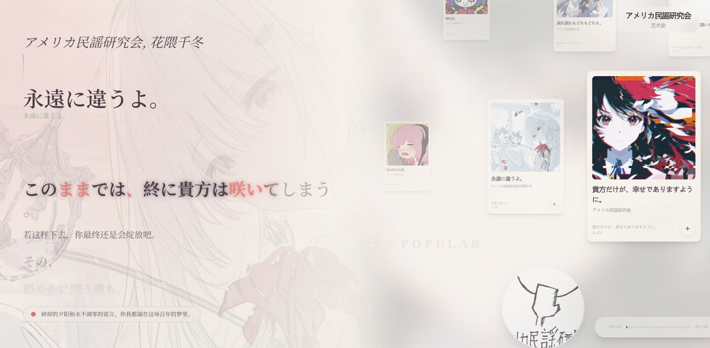

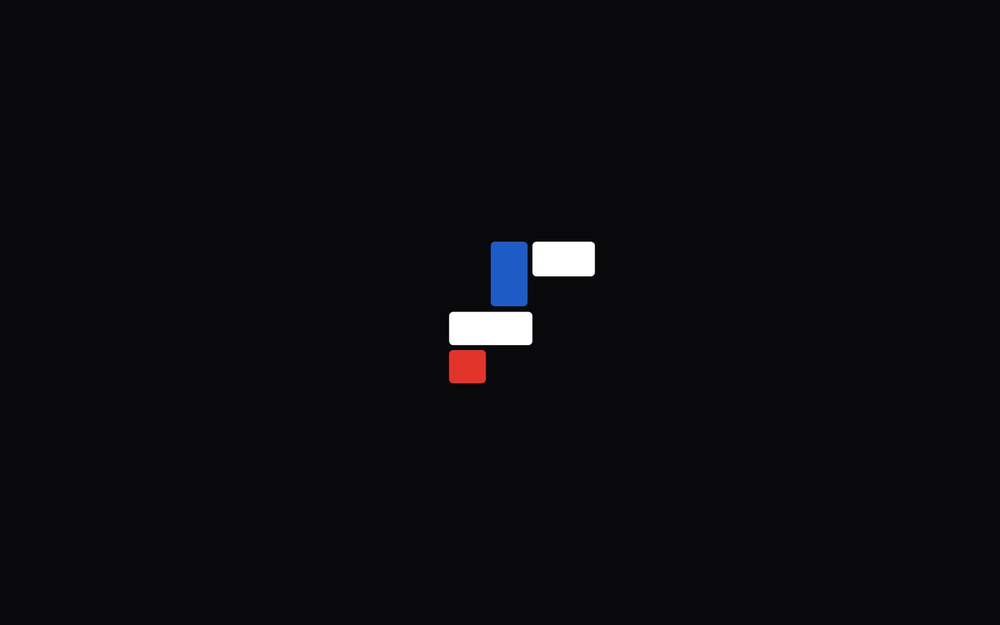


> Folia 截图仅作研究对照，版权归 Folia 项目及原作者（AGPL-3.0），不进入 brickdesk 的资源包。

### 1.2 布局

**Explore 首页**是「一个大入口 + 若干横排」的结构：第一段左侧是一张约 224px 的大封面，右侧是每列五条的小条目；后面的段落是横向滚动的封面行。每个段落有标题、标题后的细线、右侧的「更多」胶囊按钮。页面没有卡片外框，段落之间的节奏靠留白和细线，而不是背景块。

**Bravais 墙面**把「书脊」做成了结构：中间一条约 120px 的竖缝，页签竖排，像一排书脊；墙面的格子用 1px 细线切分，封面直接铺在格子里。空墙截图里能清楚看到这套骨架：没有圆角卡片、没有阴影，靠线和留白建立秩序。这个「缝」不适合直接搬到 4:3 手柄，但它说明 Folia 愿意让导航本身成为版式的一部分。

**共同点**：

- 内容优先，导航退后。标题、封面、歌词占据视觉面积，按钮和状态字很小。
- 大留白。桌面端边距大，段落之间 56–72px；这不是 4:3 小屏能照搬的数值，但「宁可少放一点」的取舍可以照搬。
- 结构靠线，不靠盒子。标题后的 rule、墙面格线、卡片 hairline，都是 1px 的低对比线。
- 首屏有主角。Explore 的第一段永远有一张明显更大的封面，其他条目是配角。

### 1.3 封面和图片

Folia 对封面的处理非常克制，值得逐条记：

- 行内封面是 162px 高，方形/圆形；宽封面 288px。大入口方形封面 224px，最宽 384px。圆角用 16–24px（`rounded-2xl`/`rounded-3xl`），不是小圆角卡片。
- 封面里缘有一圈 `ring-1 ring-inset ring-white/10` 的发丝线；默认没有阴影，只有 hover/focus 时才出现 `0 24px 40px -24px` 的柔和投影。这让整面墙在静止时保持平，不显得「每个卡片都浮起来」。
- 标题和副标题在封面**下方**，不在图上压字。歌曲条目有播放/时长小胶囊，但那是状态，不是装饰。
- 专辑封面后面会露出一圈黑胶唱片，playlist/mix 会在封面上缘露出两层纸边，artist 会裁成圆形。三种类型用形状区分，而不是给每个卡片加彩色标签。
- 封面本身承担颜色。界面不额外加彩色底、不加渐变蒙层；需要区分时只用很轻的 tint 或 hairline。
- 加载时用占位底色，失败时用唱片图标兜底；图片 `object-fit: cover`，不拉伸。

### 1.4 字体与层级

- 中文标题/段落标题/大封面标题用衬线：`Folia Noto Serif SC`（Noto Serif SC 400/500），例如段落标题 28px、大封面标题 30px。
- 卡片标题、元信息、按钮用无衬线：Inter + Noto Sans CJK。卡片标题 14px，副标题 12px，按钮 12–13px。
- 层级主要靠字号、字重和透明度，不靠颜色。标题是 `--text-primary`，副标题是 primary 的 60%，更弱的信息是 52%。
- 不用全大写英文小标题做「设计感」；Folia 的英文只出现在品牌、平台名和极少数固定术语里。这一点和用户否掉的「英文小标题」一致。
- 大标题行高很紧（约 1.1–1.2），正文约 1.4–1.5；标题的紧和正文的松形成对比。

### 1.5 配色

Folia 的主题色来自 `--bg-color`、`--text-primary`、`--text-secondary`、`--text-accent` 四个变量，界面大量使用 `color-mix()` 从文字色派生弱色：

- 默认深色：背景约 `#070707`，文字 `#f7f4ee`，强调 `#fd5c47`（珊瑚红），次强调 `#6a48ff`。
- 默认浅色：背景约 `#fafaf9`，文字 `#1c1917`。
- 线：文字色的 8%–16%；弱底：文字色的 5%–10%；面板：背景色的 85%–95% 再混一点文字色。
- 强调色只做「当前/正在播放/焦点」等少量状态；大面积仍是中性色。没有大面积渐变，没有发光。
- 浅色不是纯白，深色不是纯黑；都带一点暖/冷倾向，让封面不显得脏。

### 1.6 动效

Folia 的 Explore 动效有明确的「叙事」：

- 页面第一次出现：段落标题从自己的裁切线下方升起（0.6s），标题后的细线从左向右展开（0.8s），封面从左向右被「揭开」（0.7s，`clip-path` + `scale 1.25` + 灰度到彩色），标题在封面之后 0.18s 升起。
- 卡片用弹簧落位：`stiffness 320 / damping 31 / mass 1`，约 0.3s 稳定；大卡片用更软的 `210 / 27`。
- 换页时旧卡片在 0.16s 内绕轴转出，新卡片转入；减弱动效时全部改为 0.14s 淡入。
- 页面背后有一团「光」：取当前指向的封面，放大、模糊 100px、饱和度 150%，透明度 0.2，跟随焦点缓慢漂移，靠近视口边缘时淡出。这是 Folia 氛围感的重要来源，但也是**实时模糊**，在 GE8300 上不能直接照搬。

### 1.7 焦点

- 普通按钮/条目：`focus-visible` 用 2px 主文字色 ring。
- 墙面卡片：焦点不是反色，而是「抬升 + 环」：`0 0 0 1px 深色 / 0 0 0 4px 主文字色 / 0 0 0 5px 深色` 的三层环，外加 `0 12px 32px` 的抬升阴影；圆角跟着卡片走。
- 正在播放的卡片有自己的强调色描边；焦点时只加强内发光，不再叠第二圈不同颜色的环。
- hover 有轻微的饱和度/亮度变化；手柄场景没有 hover，焦点必须独立成立。

### 1.8 哪些能搬到 4:3 + 手柄

可以：

1. **封面优先、标题在画外**。这是最重要的一条，直接解决原型的「图上压字 + 底部渐变」问题。
2. **衬线标题 + 无衬线界面的双层字体**。在 3.95 英寸上，衬线只用于大标题/主视觉/歌词，正文仍用无衬线。
3. **一个强调色 + 中性底**。柿红只做焦点、开关、进度、当前标记。
4. **发丝线 + 低对比边界**。封面内缘、设置分隔、面板边，全部 1px。
5. **焦点环 + 抬升，而不是反色**。手柄用户需要一眼看到焦点，但不该用整行白底黑字。
6. **首屏一个主角**。保留一个大封面作为视觉锚点，其他是配角。
7. **封面自带的颜色就是墙的颜色**。用一张预烘焙的低分辨率背景图 + 平纱，替代实时模糊。
8. **「当前」和「焦点」分开**。当前页用 3px 柿红短线/点；焦点用环。两者不抢。

不直接搬：

1. **16:9 的大留白**。4:3 屏只有 1024×768，边距从桌面端的 48–72 收到 32。
2. **实时 100px 模糊光**。改成预烘焙的 512×384 背景图，平纱后以 10%–12% 露出；只在焦点切换时做 260ms 交叉淡入。
3. **封面揭开时的 clip-path + 灰度 + 缩放**。这个动画很美，但每帧都在改裁剪和滤镜；GE8300 上贵。首屏可用一次「透明度 + 1.02 缩放」的轻入场，之后不做。
4. **hover/tilt/唱片转出**。没有鼠标，全部删掉；焦点态替代 hover。
5. **竖排书脊**。4:3 上竖排中文会牺牲可读性；侧边栏仍用横排。
6. **12–14px 的桌面字号**。3.95 英寸、324ppi 上太小；正文 20px，元信息 16px。
7. **英文全大写小标题**。保留中文标题，平台名用 GBA/PS/SFC 这种必要缩写。

## 2. 现有原型审视

现有原型的结构是对的：封面墙、左侧栏、右侧快捷面板、设置页、按住提示、Toast、深浅主题、手柄映射。问题主要在视觉语法，而不是信息架构。

### 2.1 保留

- 封面墙的可平移结构，以及大小不一的磁贴。
- 游戏/应用/收藏的分类筛选；切换分类时不重排，只压暗不匹配项。
- 音乐动态磁贴，以及 X/Y 的快捷操作（暂停/下一首）。
- 左侧栏、右侧快捷面板、设置页的三套结构。
- 按住才出现的提示条，以及 Toast。
- 深浅主题和键盘/手柄测试手柄。

### 2.2 要改

| 现状 | 问题 | v2 的决定 |
| --- | --- | --- |
| 封面底部 50% 黑色渐变 + 白字 | 每张图都在重复同一种渐变；文字可读性取决于图；很「模板」 | 标题移到封面下方纸面；封面本身不加渐变 |
| 4px 纯白描边 + 非焦点压到 0.14 | 太吵，像调试边框；整面墙失去可读性 | 2px 纸色间隙 + 2px 柿红环 + 2px 抬升；非焦点只加一层轻纱 |
| 所有磁贴 6px 圆角 | 没有印刷品/封面的质感 | 16px 圆角，内缘 1px 发丝线 |
| 200px 单元、7×5 墙 | 首屏焦点居中时会把整排切一半 | 180px 单元、16px 间距；焦点接近边缘才平移 |
| 中性灰 + 默认蓝 | 没有品牌记忆点；蓝色像系统默认 | 暖纸/暖墨 + 柿红；一个强调色 |
| 15–17px 的中文标签 | 3.95 英寸上偏小 | 正文 20px，元信息 16px，最小中文句子不小于 16px |
| 顶栏四个文字 tab | 可用但普通，没有版式 | 保留 tab，但加品牌标记、细线、短下划线；不加胶囊底 |
| 侧边栏/设置焦点整行反色 | 对比过猛，像选中一行表格 | 2px 内嵌柿红环 + 轻表面 + 左侧当前线；不反色 |
| 快捷面板塞了两条假通知 | 装饰性假数据，用户明确否掉 | 删除通知；换成真实的「正在播放」卡 |
| 设置是两条平铺列表 | 没有分组和层级 | 左侧分类 + 右侧圆角设置表；说明文字只在需要的行出现 |
| 提示条是底部整宽渐变 | 大面积渐变，且会盖住内容 | 底部悬浮的深/浅反色胶囊，只在按住时出现 |
| Select 按一次显示、再按打开快捷设置 | 和「按住才显示」冲突 | 按住 Select = 提示；Start = 快捷面板（需拍板） |

### 2.3 新方向：纸面书架

一句话：**封面是印在纸上的画，界面是纸边的铅笔线，柿红是唯一的一枚书签。**

- 图先于框：先放封面，再考虑标题、状态、按钮。
- 字有主次：主视觉/页面标题用衬线，操作和元信息用无衬线。
- 一个强调色：柿红只出现在焦点、开关、进度、当前标记。
- 边缘要呼吸：墙和面板都留 32px 安全边；内容可以出血，但文字不贴边。
- 动效只做位移和透明度：不做实时模糊、不做滤镜、不做大面积阴影动画。

## 3. 设计规范

### 3.1 屏幕与栅格

| 项 | 值 | 说明 |
| --- | --- | --- |
| 画布 | 1024×768 | 4:3，按 1× 设计；所有尺寸是设备像素 |
| 屏幕 | 3.95 英寸 | 约 324ppi；1px ≈ 0.078mm，20px ≈ 1.57mm |
| 安全边 | 32px | 顶栏左右、设置页左右 |
| 顶栏 | 76px | 主页/设置共用 |
| 墙起点 | left 24px，top 94px | 墙内容可以出血，文字仍留边 |
| 封面单元 | 180×180px | 7×5 墙，墙尺寸 1260×900 |
| 磁贴间距 | 16px | 视觉间隙；圆角和焦点环不互相咬 |
| 首屏可视区 | 976×630px | 墙在 y=94 到 y=724 之间 |
| 侧边栏 | 360px | 覆盖式，不挤压墙 |
| 快捷面板 | 420px | 覆盖式 |
| 设置分类栏 | 232px | 与右侧内容间距 28px |
| 圆角 | 16 / 12 / 9 / 20px | 封面 / 行 / 键帽 / 对话框 |
| 基础间距 | 4px | 4、8、12、16、24、32、48、64 |

焦点平移不是「永远居中」：

- 水平安全边 32px；焦点左边小于当前平移 + 32 时向左补，右边超出视口 −32 时向右补。
- 垂直安全边 88px（顶）/46px（底）；只在焦点接近边缘时补。
- 这样首屏、主视觉、音乐磁贴都能完整落在画面里，不会出现「半张封面 + 半行标题」。

### 3.2 字号层级

3.95 英寸、324ppi 下，中文正文不要小于 20px；16px 只用于元信息/说明；11–14px 只用于键帽、时间码、状态缩写。

| 角色 | 字号/行高 | 字体/字重 | 用途 |
| --- | --- | --- | --- |
| 页面标题 | 34/1.15 | 衬线 500 | 设置页「设置」 |
| 分类标题 | 32/1.2 | 衬线 500 | 设置「显示」 |
| 面板标题 | 30/1.2 | 衬线 500 | 菜单、快捷设置 |
| 主视觉标题 | 28/1.2 | 衬线 500 | 3×2 大封面标题 |
| 大磁贴标题 | 22/1.25 | 无衬线 600 | 2×2 磁贴 |
| 磁贴标题 | 20/1.25 | 无衬线 600 | 普通磁贴 |
| 小磁贴标题 | 18/1.25 | 无衬线 600 | 1×1 磁贴 |
| 列表标题 | 20/1.25 | 无衬线 500/600 | 侧边栏、设置行、快捷行 |
| 正文 | 18–20/1.5 | 无衬线 400 | 对话框正文、设置说明 |
| 元信息 | 16/1.35 | 无衬线 400 | 封面副标题、设置说明 |
| 弱信息 | 15–16/1.4 | 无衬线 400 | 面板时间、数字/短标签可用 15 |
| 提示条 | 17/1.2 | 无衬线 500 | 按键提示 |
| 键帽/时间码 | 11–14 | 无衬线 600 / 表格数字 | 只用于短标签 |

字体文件：

- 无衬线：Inter（拉丁/数字）+ Noto Sans SC 子集（中文）。现有原型已带 `inter-latin-wght-normal.woff2` 和 `noto-sans-sc-subset.woff2`。
- 衬线：Noto Serif SC 500，`noto-serif-sc-500.woff2`，约 1.5MB。只用于标题、主视觉、歌词、对话框标题。
- 中文衬线在小字号下容易糊；所以 20px 以下不用衬线。
- Noto Serif SC 为 OFL 授权，可随固件分发；如果最终固件要极限压缩体积，可只打包用到的汉字子集；但标题字重不能只留 400，500 更稳。

### 3.3 颜色 token

#### 浅色：暖纸

| token | 值 | 用途 | 对比 |
| --- | --- | --- | --- |
| `--bg` | `#F2EDE3` | 页面底 | — |
| `--bg-deep` | `#E7E0D3` | 环境底、空态 | — |
| `--surface` | `#FBF7EF` | 面板、设置表、对话框 | — |
| `--surface-2` | `#EEE7DA` | 焦点行、次级表面 | — |
| `--surface-3` | `#E3DACB` | 滑块轨道、开关轨道 | — |
| `--ink` | `#1E1A15` | 主文字 | 14.8:1 |
| `--ink-2` | `#5C554A` | 次级文字 | 6.3:1 |
| `--ink-3` | `#6F675B` | 弱信息 | 4.8:1 |
| `--line` | `rgba(30,26,21,.12)` | 分隔线 | — |
| `--line-strong` | `rgba(30,26,21,.22)` | 控件边、键帽边 | — |
| `--accent` | `#AE432B` | 焦点、开关、进度 | 4.95:1 |
| `--accent-strong` | `#963823` | 按下/强调 | — |
| `--on-accent` | `#FFF8F2` | 强调底上的字 | 5.49:1 |
| `--scrim` | `rgba(26,21,16,.42)` | 面板/对话框遮罩 | — |
| `--art-veil` | `rgba(242,237,227,.12)` | 非焦点封面纱 | — |

#### 深色：暖墨

| token | 值 | 用途 | 对比 |
| --- | --- | --- | --- |
| `--bg` | `#12100D` | 页面底 | — |
| `--bg-deep` | `#0B0A08` | 环境底 | — |
| `--surface` | `#1C1915` | 面板、设置表、对话框 | — |
| `--surface-2` | `#25211B` | 焦点行、次级表面 | — |
| `--surface-3` | `#2F2A22` | 滑块轨道、开关轨道 | — |
| `--ink` | `#F3EDE2` | 主文字 | 16.3:1 |
| `--ink-2` | `#B9AFA0` | 次级文字 | 8.8:1 |
| `--ink-3` | `#918879` | 弱信息 | 5.4:1 |
| `--line` | `rgba(243,237,226,.12)` | 分隔线 | — |
| `--line-strong` | `rgba(243,237,226,.22)` | 控件边、键帽边 | — |
| `--accent` | `#E07A5F` | 焦点、开关、进度 | 6.44:1 |
| `--accent-strong` | `#F08D71` | 按下/强调 | — |
| `--on-accent` | `#1A120E` | 强调底上的字 | 6.26:1 |
| `--scrim` | `rgba(0,0,0,.62)` | 面板/对话框遮罩 | — |
| `--art-veil` | `rgba(18,16,13,.26)` | 非焦点封面纱 | — |

规则：

- 强调色不写正文；只做环、开关、进度、当前短线。浅色 `#AE432B` 在纸底上的对比是 4.95:1，刚好够小字，但不要拿它写长句。
- 环境图的有效可见度约 10%–12%：深色纱 `rgba(18,16,13,.88)`，浅色纱 `rgba(242,237,227,.90)`。
- 缺图应用的材质色只用低饱和的一组：苔绿 `#6D7A63`、靛青 `#4C5C70`、陶土 `#A8674F`、赭黄 `#B08A4F`、板岩 `#5A5C5E`。文字用 `#F3EDE2`。

### 3.4 焦点

焦点必须同时满足「远看能认出」和「近看不脏」：

- 封面：`0 0 0 2px var(--bg), 0 0 0 4px var(--accent)`，外加 `translateY(-2px)` 和静态的 `0 22px 38px -26px` 阴影。环围绕封面画，标题保持原位。
- 非焦点封面：加一层 `--art-veil`，透明度 0.92；不是把整张卡压到 0.14。墙仍然可读，焦点自然浮出。
- 列表行：`inset 0 0 0 2px var(--accent)` + `background: var(--surface-2)`；图标变强调色；文字不反色。
- 当前项：左侧 3px 柿红短线（列表）或强调色（正在播放）。当前项同时被聚焦时隐藏短线，只留焦点环，避免双线。
- 对话框按钮：2px `outline`，offset 2；主按钮用 `--ink` 描边，避免柿红环叠在柿红底上。
- 不用纯白 4px 描边，不用整行反色，不用仅靠颜色区分焦点。

### 3.5 动效

| 场景 | 时长 | 曲线 | 属性 | 成本 |
| --- | --- | --- | --- | --- |
| 焦点环/文字色 | 120ms | ease-out | color/box-shadow | 一次重绘 |
| 封面抬升 | 160ms | ease-out | transform | 合成，便宜 |
| 墙平移 | 220ms | ease-out | translate3d | 合成，便宜 |
| 面板滑入 | 200ms | ease-out | translate3d | 合成，便宜 |
| 遮罩 | 160ms | ease-out | opacity | 合成，便宜 |
| 环境图切换 | 260ms | ease-out | opacity（两张图交叉） | 两张全屏 quad |
| 设置页切换 | 180ms | ease-out | opacity + 8px translate | 便宜 |
| Toast | 160/120ms | ease-out | opacity + 8px translate | 便宜 |
| 动态进度条 | 320ms | linear | width | 小面积重绘 |
| 首屏入场（可选） | 280ms | ease-out | opacity + 6px translate | 一次 |

不要做：

- 实时模糊/背景滤镜（Folia 的 100px blur 只能预烘焙）。
- 大面积 box-shadow 动画（阴影每帧重绘，GE8300 上很贵）。
- `clip-path` 揭开 + `grayscale` 同时动画（Folia 的 0.7s 封面揭开）。

减弱动效：

- 所有位移/弹簧改为 80ms 淡入或直接切换。
- 环境图不交叉淡入，直接换图。
- 墙平移不动画；焦点仍保留环。

### 3.6 图标

- 线性图标，24px 网格，1.75px 描边，圆头圆角；尺寸 20（行内）、24（列表/按钮）、28（面板标题旁）。
- 只用一种风格，不混填充/双色/彩色底；不用 emoji。
- 应用图标在标题前 18px；缺图时在封面中央 64px。
- 键帽字母 11px/600，数字用表格数字。
- 图标颜色跟随 `--ink-2`/`--ink-3`；焦点时变 `--accent`。

### 3.7 组件

#### 顶栏与分类 tab

- 高 76px，左右 32px，底边 1px `--line`。
- 左侧品牌标记 14×14 的 2×2 方块 + `brickdesk` 15px/600 `--ink-2`。
- 分类 20px；未选 `--ink-3`，选中 `--ink` 600；选中下划线 22×2px，距底 17px，柿红。
- 右侧 Wi-Fi 22px、电池 32×16、时间 20px 表格数字；全部 `--ink-2`。
- 不加胶囊底、不加彩色 tab、不加英文 eyebrow。

#### 封面磁贴

| 尺寸 | 实际像素（180 单元 / 16 间距） | 标题 | 说明 |
| --- | --- | --- | --- |
| 1×1 | 164×164 | 18px | 小工具/终端；只显示标题 |
| 2×1 | 344×164 | 20px | 文件、相册、阅读 |
| 1×2 | 164×344 | 20px | 音乐、雾港、无线传输 |
| 2×2 | 344×344 | 22px | 深井、设置、星海 |
| 3×2 | 524×344 | 28px 衬线 | 主视觉小镇四季 |

- 封面圆角 16px，内缘 1px `--line-strong`；标题在封面下方 10px。
- 标题行可带 18px 应用图标；游戏不带图标。
- 副标题 16px `--ink-2`，一行省略；1×1 不显示副标题。
- 默认不加阴影；焦点才抬升。
- 缺图：材质色 + 64px 图标；再缺图标：首字 + 材质色。

#### 动态磁贴

- 结构与封面磁贴一致；1×2 时封面高 190px，文字区 146px。
- 文字区：`音乐` + 14px「播放中」状态；曲名 18px 衬线 + 艺术家 15–16px 无衬线；歌词 16px 衬线、1.5 行高、两行截断；底部 3px 进度条 + 14px 时间。
- 状态更新 1Hz；进度条 320ms 线性；不做均衡器跳动、不做实时模糊、不做唱片旋转。
- 焦点在动态磁贴上时，提示条显示 X 暂停/播放、Y 下一首；X/Y 不进入应用。

#### 侧边栏

- 宽 360px，`--surface`，右侧 1px `--line`，无大面积阴影；后面 `--scrim` 0.62。
- 头部 100px：标题 30px 衬线 + 右侧时间 15px。
- 行高 56px，左右 14px，圆角 12px；图标 25px；标签 20px。
- 当前页：3px 柿红短线；焦点：`--surface-2` + 2px 内嵌环；两者同时出现时隐藏短线。
- 分组之间 16px + 1px 线；设置/电源固定在底部；底部 72px 键位说明。
- 电源子菜单共用同样行高；关机再弹确认框。

#### 快捷面板

- 宽 420px，`--surface`，左侧 1px `--line`。
- 头部 100px：标题 30px 衬线；右侧「电量 82%」15px。
- 正在播放卡：78px 封面 + 曲名 20px 衬线 + 艺术家 16px + 3px 进度 + 34px 播放按钮；这是真实数据，不是装饰。
- 控制行高 56px：亮度、音量、Wi-Fi、蓝牙、主题；图标 25px；标签 20px。
- 滑块轨道 132px，开关 44×26；焦点行同设置行。
- 删除假通知；如果以后要做通知，必须是系统真实事件。

#### 设置行

- 顶部 76px 页面头：返回 24px + 「设置」34px 衬线 + 状态。
- 左侧 232px 分类，行高 54px，图标 24px，标签 19px；右边 1px 线。
- 右侧分类标题 32px 衬线 + 说明 16px；设置表圆角 18px，`--surface`，1px `--line`。
- 行高 66px；带说明的行 78px；标签 20px，说明 16px，值 18px；行间 1px 线。
- 焦点行：`--surface-2` + 2px 内嵌柿红环；首/末行圆角跟随设置表。
- 值：select 显示「‹ 浅色 ›」，只有焦点时显示两侧箭头；slider 右侧数值；toggle 显示「开/关」+ 44×26 开关；info 只显示弱化值。

#### 滑块

- 轨道 4px，圆角 2px，`--line-strong`；填充 `--accent`。
- 滑块 14px，`--surface` 底 + 1.5px 柿红环；焦点时 16px + 3px 环。
- 数值 18px，最小宽度 32px，右对齐，表格数字。
- 只支持左右步进（5%），不做触屏拖动。

#### 开关

- 44×26px，圆角 13px；轨道 `--surface-3` + 1px `--line`；开启 `--accent`。
- 滑块 20px，`--ink-2`；开启时 `--on-accent`。
- 焦点时在开关外加 2px 纸色 + 1px 柿红环；不要发光。

#### 对话框

- 560px 宽，居中；`--surface`，1px `--line`，圆角 20px，内边距 28px。
- 标题 30px 衬线；正文 18px/1.55 `--ink-2`；底部按钮高 48px，最小宽 112px，圆角 12px。
- 取消按钮 `--surface-2`；确认按钮 `--accent` + `--on-accent`。
- 遮罩 `--scrim`，无背景模糊；焦点 2px outline，offset 2。
- 危险操作默认焦点在「取消」，不默认聚焦确认。

#### 提示栏

- 只在按住 Select 时出现；松开即收起，不做自动消失的「toast 化」。
- 高 60px，距底 22px，水平居中；`--ink` 底 + `--bg` 字（深浅主题自动反色），圆角 16px。
- 两组按键：左组系统键（MENU/START），右组上下文键（L1/R1、X/Y、A）；中间 1px 分隔线。
- 键帽 25px 高，11px/600；标签 17px。
- 不用底部整宽渐变，不遮挡焦点区域；内容多时优先保留 A/B 和上下文键。

#### Toast

- 顶部 18px，高 54px，圆角 14px；`--ink` 底 + `--bg` 字；17px。
- 进入 160ms（上移 8px），退出 120ms；1.9s 后消失；不堆叠，新的替换旧的。
- 只用于结果反馈，不用来放装饰性内容。

#### 缺图/材质封面

- 材质色 + 64px 线性图标；图标占中央，不加渐变。
- 终端这类工具可以用 `>_` 作为字形封面；仍然保留标题在下方。
- 任何缺图都不能出现破图图标或空白方块。

### 3.8 4:3 与手柄导航

- 墙是 7×5 的离散格，不是自由 2D 光标；十字键在矩形之间找最近邻，优先同轴、再考虑重叠和中心偏移。
- 焦点接近视口边缘才平移；不要在每次移动时把墙拉回中心，否则 4:3 上会频繁切断整排封面。
- 分类切换不重排墙；只把非当前分类压暗并跳过焦点。这样空间记忆不丢。
- 没有 hover；所有 hover 效果删掉，焦点态必须独立成立。
- 手柄映射（v2 建议）：

| 按键 | 主页 | 侧边栏 | 快捷面板 | 设置 |
| --- | --- | --- | --- | --- |
| 十字键 | 移动焦点 | 移动 | 移动/调整 | 移动/调整 |
| A | 打开 | 进入 | 切换 | 进入/切换 |
| B | 根页面 | 关闭/返回 | 关闭 | 返回 |
| X / Y | 动态磁贴快捷操作 | — | — | — |
| L1 / R1 | 切换分类 | — | — | — |
| Menu | 开/关侧边栏 | 关闭 | 关闭 | 开/关侧边栏 |
| Start | 开/关快捷面板 | 关闭并打开快捷 | 关闭 | 开/关快捷面板 |
| Select（按住） | 提示栏 | 提示栏 | 提示栏 | 提示栏 |

- 这是对原型的**行为变更**：原来 Select 按一次显示、再按一次开快捷；现在按住 Select 只做提示，Start 负责快捷面板。需要用户确认。
- 3.95 英寸上，一屏不要超过 6 行设置；超出的分类在面板内滚动，滚动条不画，用上下淡出提示。

## 4. 应用大图规范草案

### 4.1 目录与清单

每个应用一个目录，清单文件名 `manifest.json`，图片相对清单所在目录：

```text
apps/music/
  manifest.json
  art/
    icon.png
    cover-1x1.jpg
    cover-2x1.jpg
    cover-1x2.jpg
    cover-2x2.jpg
    cover-3x2.jpg
    backdrop.jpg
  state/
    tile.json
```

```json
{
  "schema": 1,
  "id": "com.example.music",
  "name": "音乐",
  "subtitle": "本地曲库与播放",
  "type": "app",
  "accent": "#7B5A8C",
  "art": {
    "icon": "art/icon.png",
    "covers": {
      "1x1": "art/cover-1x1.jpg",
      "2x1": "art/cover-2x1.jpg",
      "1x2": "art/cover-1x2.jpg",
      "2x2": "art/cover-2x2.jpg",
      "3x2": "art/cover-3x2.jpg"
    },
    "backdrop": "art/backdrop.jpg",
    "fallbackColor": "#7B5A8C"
  },
  "live": {
    "provider": "builtin.now-playing",
    "state": "state/tile.json",
    "refreshMs": 1000,
    "fields": ["title", "subtitle", "progress", "artwork"]
  }
}
```

### 4.2 字段

| 字段 | 必填 | 类型/限制 | 说明 |
| --- | --- | --- | --- |
| `schema` | 是 | `1` | 清单版本；未知版本按不支持处理 |
| `id` | 是 | `[a-z0-9._-]{1,64}` | 反向域名式唯一 ID |
| `name` | 是 | 1–12 个汉字/24 字符 | 磁贴标题；超出截断 |
| `subtitle` | 否 | ≤ 32 字符 | 副标题；小磁贴不显示 |
| `type` | 是 | `app` / `game` | 决定默认图标/分类 |
| `accent` | 否 | `#RRGGBB` | 缺图时的材质色；不用于正文 |
| `art.icon` | 否 | PNG，96×96 | 标题前 18px、缺图封面中央 64px |
| `art.covers` | 否 | 见尺寸表 | 按 span 命名；缺失走回退 |
| `art.backdrop` | 否 | 1024×768 或 512×384 | 环境底图；无文字、无小细节 |
| `art.fallbackColor` | 否 | `#RRGGBB` | 无 accent 时的材质色 |
| `live.provider` | 否 | `builtin.now-playing` / `file` / `none` | v1 只建议内置正在播放 |
| `live.state` | 否 | 相对路径 | provider=file 时读取的 JSON |
| `live.refreshMs` | 否 | 500–5000 | 轮询间隔；默认 1000 |
| `live.fields` | 否 | 字符串数组 | 允许 `title`、`subtitle`、`progress`、`artwork` |

安全与边界：

- 清单只允许 JSON，不允许 HTML/JS/CSS；桌面只读取声明过的图片与 state 文件。
- 所有路径必须是相对路径，拒绝 `..`、绝对路径、符号链接逃逸。
- 未知字段忽略；字段超长截断；解析失败按静态封面处理。
- 应用不能指定系统字体、阴影、渐变、动画曲线；这些由桌面统一。

### 4.3 图片尺寸与格式

| 资源 | 目标显示尺寸 | 建议源尺寸（2×） | 格式 | 单文件上限 |
| --- | --- | --- | --- | --- |
| icon | 18/64px | 96×96 | PNG-24（可透明） | 64KB |
| 1×1 封面 | 164×164 | 512×512 | JPEG q82 / PNG | 250KB |
| 2×1 封面 | 344×164 | 1024×512（2:1） | JPEG q82 | 350KB |
| 1×2 封面 | 164×344 | 512×1024（1:2） | JPEG q82 | 350KB |
| 2×2 封面 | 344×344 | 1024×1024 | JPEG q82 | 400KB |
| 3×2 封面 | 524×344 | 1536×1024（3:2） | JPEG q82 | 500KB |
| backdrop | 全屏 | 1024×768（4:3） | JPEG q80 | 400KB |
| 动态封面 | 190px 高 | 512×512 | JPEG q82 | 250KB |

规则：

- 源图按 2× 提供，桌面在安装/首次加载时缩到显示尺寸；运行时不再做大幅缩放。
- 色彩空间 sRGB；不要嵌入 ICC；封面不要 alpha；图标才允许 alpha。
- JPEG 用 baseline，不用 progressive（更省解码器依赖）；如果最终使用 libjpeg-turbo，progressive 也可以，但要统一。
- 不在封面里烘焙标题、价格、角标、阴影或圆角；圆角/描边由桌面画。
- 主体/人脸放在中央 80%；四周留 24px 安全边；3×2 主视觉不要把小字放在边缘。
- 深浅主题共用一套图；不要为深色再烘一套图。环境底图会被桌面平纱。
- 不要动画 GIF/APNG；动态磁贴只更新文字/进度/一张封面。

### 4.4 缺图回退

按顺序取第一个可用项：

1. 请求的 span 对应封面（例如 3×2）。
2. 同方向最接近比例：3×2 → 2×1 → 1×1；1×2 → 1×1。
3. `1x1` 封面。
4. `accent`/`fallbackColor` 材质 + `icon`。
5. 材质 + 应用名首字（最多 1 个汉字/字符）。
6. 中性 `--surface-2` + 通用 info 图标。

其他回退：

- backdrop 缺失：用当前封面 `cover` 裁切 + 平纱；再缺：材质色平铺。
- 封面解码失败：当作缺失；不显示破图。
- 动态数据缺失：显示静态封面 + `subtitle`；不显示空进度条。
- 动态数据超过 10s 未更新：保留最后一帧，整体 60% 不透明度；不要闪回静态。
- 动态封面图失败：保留上一张；没有上一张则用静态封面。
- accent 缺失：安装时取封面主色（ quantization 到 8 色），失败则用陶土 `#A8674F`。
- 字体缺字：回退到系统中文衬线/无衬线；仍缺则显示方块前记录日志。

### 4.5 动态磁贴数据

`builtin.now-playing` 由桌面直接读取播放服务；第三方应用可用 `provider: "file"` + `state` 文件：

```json
{
  "title": "夜航",
  "subtitle": "林间电台",
  "progress": 0.38,
  "artwork": "art/live.jpg",
  "updatedAt": 1760000000
}
```

- `title` ≤ 24 字符，`subtitle` ≤ 32 字符；纯文本，不解析 HTML。
- `progress` 0–1；缺失则不画进度条。
- `artwork` 可选，512×512，JPEG；只允许相对路径。
- 文件上限 4KB；每秒读一次；解析失败保留上一帧。
- 磁贴只显示 1 行曲名 + 2 行歌词/副标题 + 3px 进度；不做频谱、不做视频、不做模糊。
- 应用退出后保留最后一次快照，标记为暂停；重新启动后覆盖。

### 4.6 内存与性能预算

- 纹理按显示尺寸解码：1×1 用 256×256，2×1 用 512×256，3×2 用 768×512；不把 1536×1024 原图常驻。
- 不透明封面用 RGB565；图标用 RGBA4444；backdrop 512×384 RGB565。
- 同时常驻 8–12 张封面 + 1 张 backdrop + 1 张动态封面；LRU 淘汰。
- 12 张 512² RGB565 约 6MB；backdrop 约 0.4MB；纹理总预算控制在 16MB 内。
- 只画视口内磁贴；墙外用 scissor 裁掉；不做全墙离屏纹理。
- 安装时生成缩略图和主色缓存；运行时只读缓存。

## 5. C + SDL2 + GLES2 实现备注

绘制顺序（从后到前）：

1. 清屏为 `--bg`。
2. 环境底图：一张 512×384 纹理，全屏 quad，透明度约 0.12；上面盖一层平色纱（`--bg`，alpha 0.88/0.90）。不要 blur。
3. 封面墙：只画视口内磁贴；每张一个纹理 quad + 圆角遮罩/9-slice；非焦点加一层半透明纱（顶点色 alpha）。
4. 标题/元信息：字形图集，按整数像素落位；不要每帧重建纹理。
5. 焦点环：9-slice 或 SDF 圆角矩形；外环 2px，纸色间隙 2px；阴影用预烘焙的 9-slice 半透明图，不实时算。
6. 顶栏、面板、设置表：纯色 quad + 1px 线 quad + 文本；面板整体平移。
7. 提示栏/Toast/对话框：纯色 quad + 文本；对话框遮罩一层 alpha。

便宜/贵：

| 操作 | 成本 | 建议 |
| --- | --- | --- |
| 纯色/纹理 quad | 极低 | 主力 |
| 线性渐变 | 低 | 只用于边缘 24–40px 的淡出，不做整屏 |
| 半透明叠层 | 低 | 环境 1 层 + 纱 1 层；面板 1 层 |
| 圆角 9-slice | 低 | 预烘焙，按颜色 tint |
| 文本图集 | 低 | 预生成 16/18/20/28/34 五档 |
| 实时 blur | 高 | 禁用 |
| 大面积阴影 | 中高 | 预烘焙成 9-slice，静态 |
| clip-path/灰度动画 | 高 | 不做；最多首屏 opacity+scale |
| 全屏 FBO | 高 | 不做 |

其他：

- 用 `glScissor` 裁墙视口；部分露出的磁贴仍然画，但不要画整张 1536 大图。
- 圆角用 SDF shader 或 9-slice；SDF 更省纹理，9-slice 更简单；二选一，不要每个磁贴换 shader。
- 文本用 FreeType 生成 R8 图集；中文按使用频率预载常用字，缺字按需上传单字纹理，避免每帧上传。
- 字体大小用整数，位置取整；1px 发丝线用 quad 而不是 line primitive（不同 GPU 线宽不一致）。
- 焦点环变化只改 quad 尺寸/颜色；不要每帧重建顶点缓冲。
- 动态磁贴的文字每秒更新一次即可；进度条用 3px quad 改宽度，不做逐帧动画。
- 面板滑入用 `translate3d` 等价矩阵；遮罩用 alpha；不要用 blur 做「毛玻璃」。
- 目标 60fps：<100 draw call，<16 张常驻纹理，无每帧分配；如果掉帧，先减环境层/阴影，不要减字号。

## 6. 原型说明

- 入口：`prototype/v2/index.html`；拆分为 `css/tokens.css`、`base.css`、`panels.css`、`settings.css`、`overlays.css`，脚本为 `js/icons.js`、`data.js`、`app.js`。
- 1024×768 固定画布；浏览器里的缩放手柄只用于试用，不属于产品 UI。
- 截图参数见 `prototype/v2/README.md`；`capture=1` 会隐藏测试手柄并固定 1×。
- 示例内容为虚构应用/游戏/歌曲，仅用于视觉稿；接入真实数据时替换 `js/data.js`。

### 深色主页


### 浅色主页

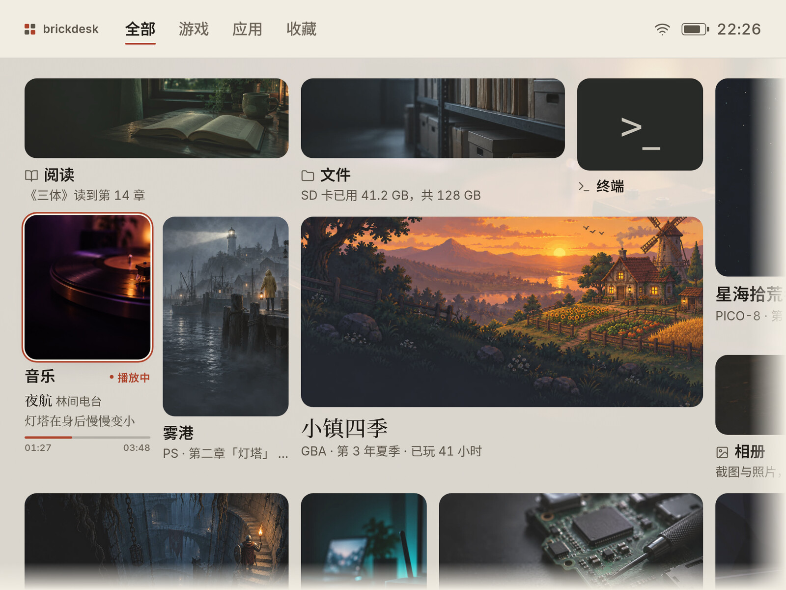

### 侧边栏

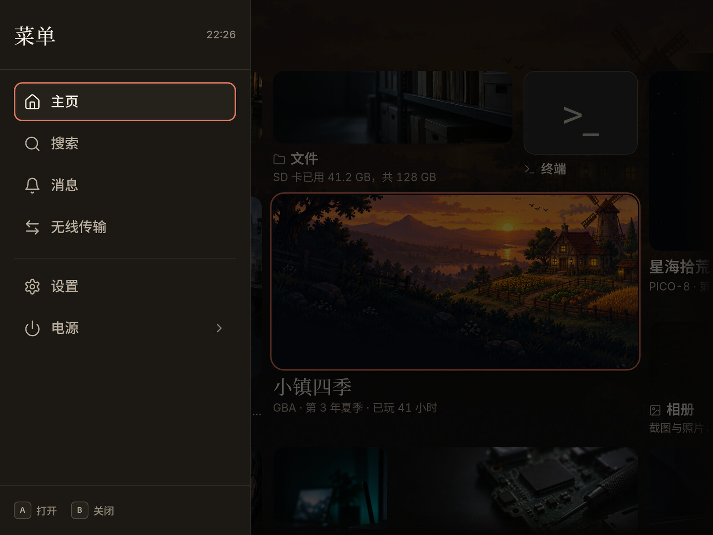

### 设置页（浅色）

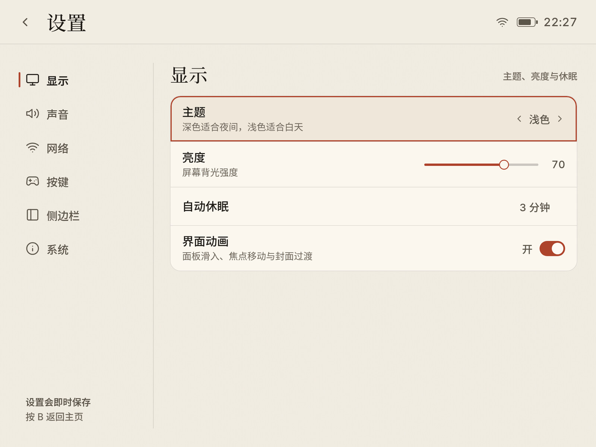

### 设置页（深色）

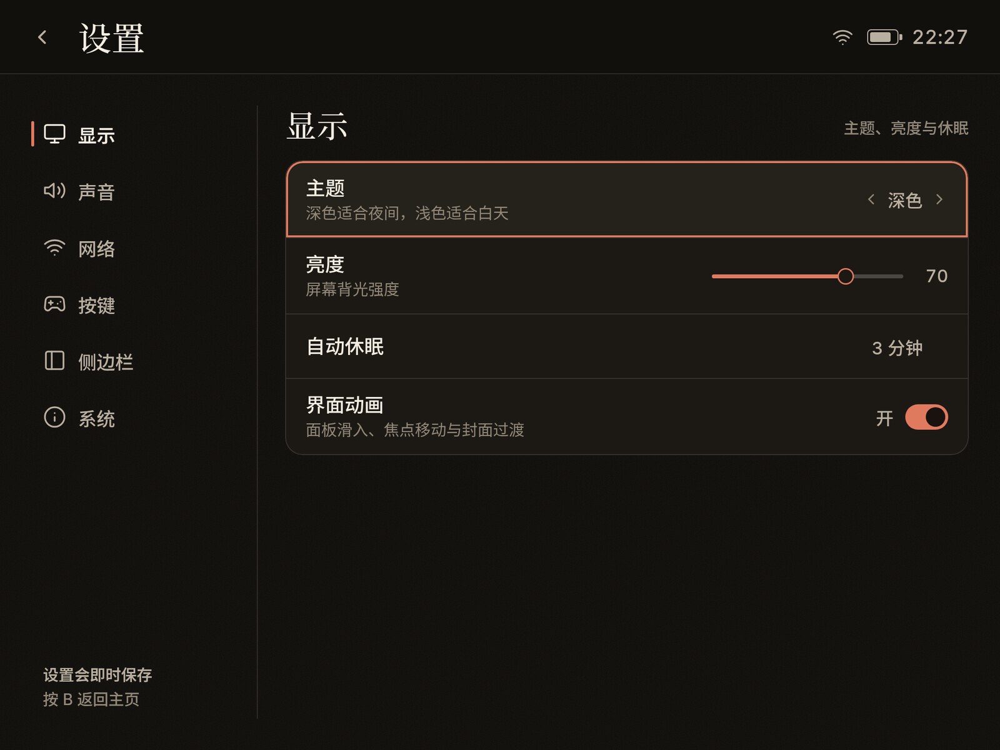

### 按住提示栏

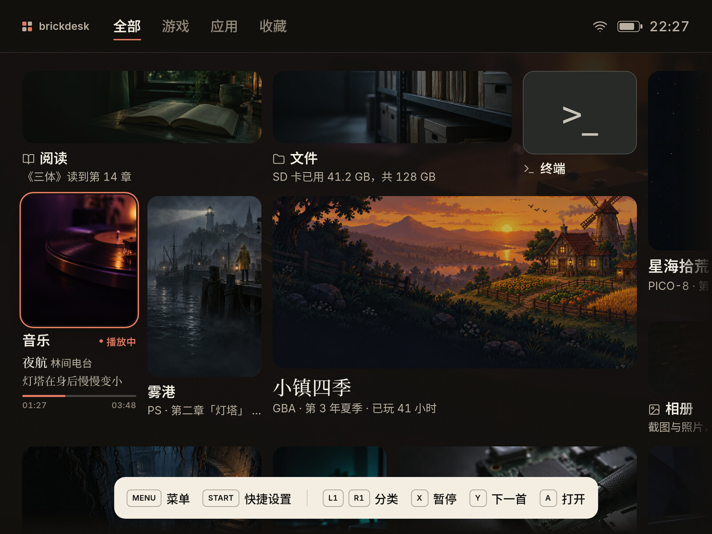

### 快捷面板

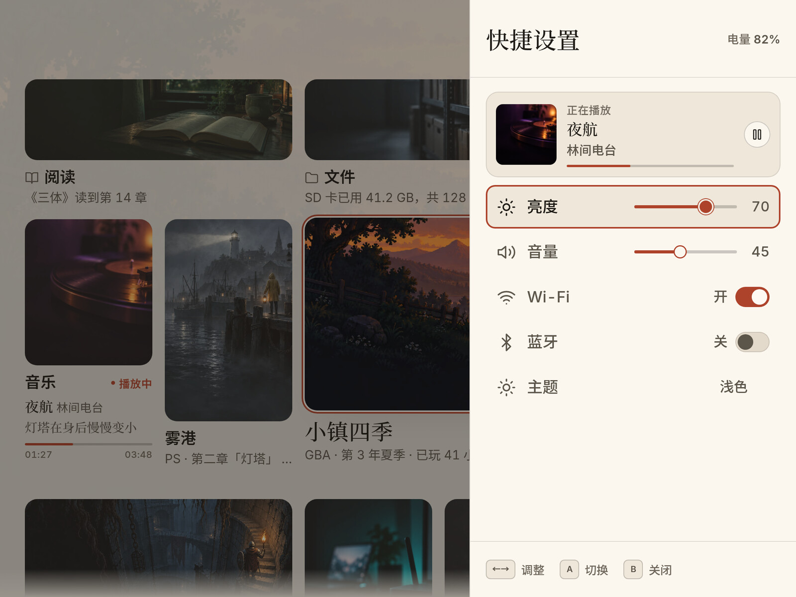

### 对话框

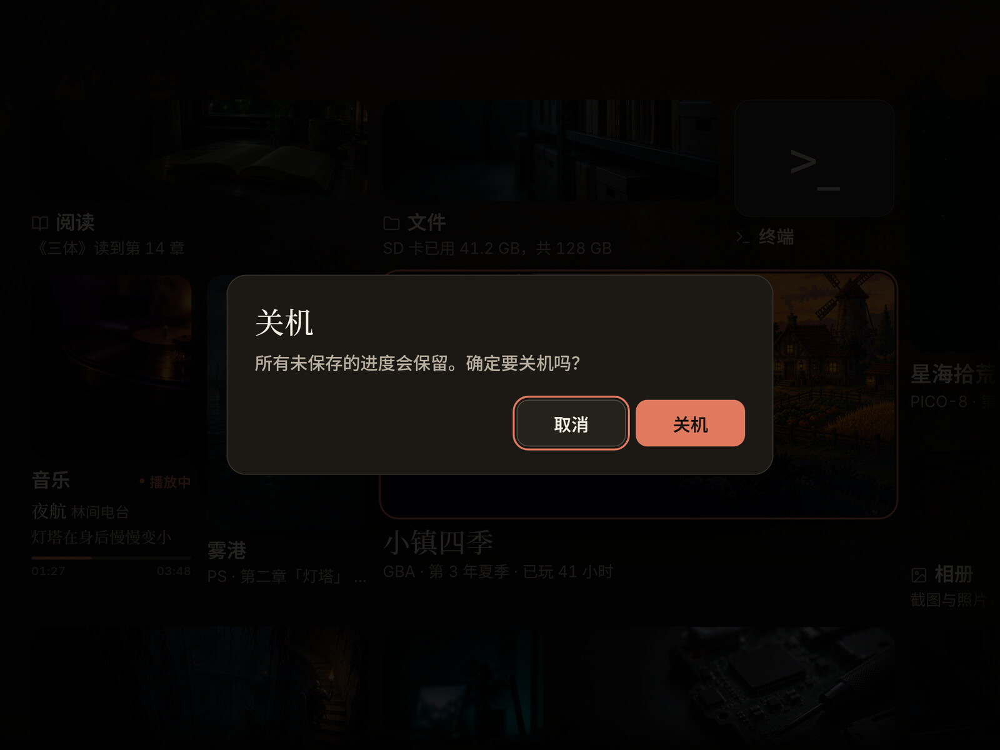

### Toast

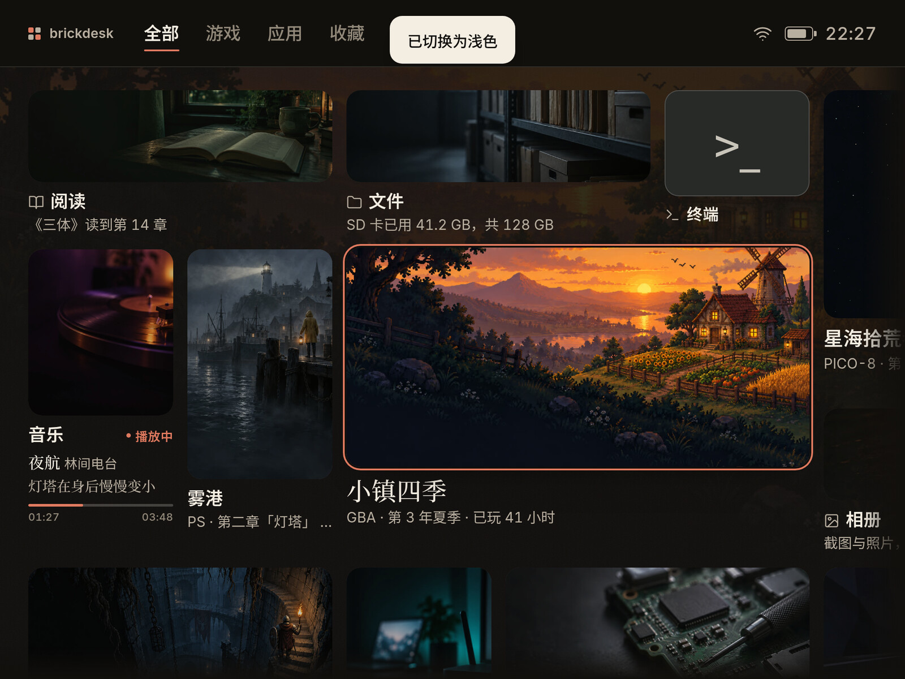

## 7. 需要拍板的选项

1. **强调色**：推荐柿红（浅 `#AE432B` / 深 `#E07A5F`）。备选是 Folia 的珊瑚红 `#FD5C47`（更跳）或深青（更冷）。柿红在纸/墨底上都能过 4.5:1，且不会变成「游戏 RGB」。
2. **默认主题**：推荐深色默认、浅色手动。若设备多在白天使用，可改浅色默认。
3. **快捷面板触发**：推荐 Start；Select 改为按住提示。若坚持原行为（Select 按两次开快捷），需要重新定义「按住提示」的冲突。
4. **墙密度**：推荐 7×5 / 180px 单元。应用数量超过约 30 个时，改 8×5 / 168px 或做分页；不要在同屏继续缩小字号。
5. **应用封面要求**：推荐至少提供 1×1 + 2×1 + 1×2 + 3×2 四种比例；只想交一张方图的应用允许回退裁切，但主视觉位置会差。要不要强制四种？
6. **动态磁贴范围**：推荐 v1 只做内置正在播放；第三方 `state/tile.json` 放 v2。若要一开始就开放，需要先定安全边界和轮询策略。
7. **环境底图**：推荐保留「预烘焙封面 + 平纱」，成本是一张 512×384 纹理和一层面纱；如果追求最低开销，可改为纯色底，但会失去 Folia 那种「房间被封面照亮」的感觉。
8. **衬线字体体积**：推荐内置 Noto Serif SC 500 子集（当前约 1.5MB）。若不接受体积，可退回系统宋体，但不同设备观感会漂移。

## 附录：Folia 参考文件

- 首页与封面行：`src/components/app/home/explore/ExploreLead.tsx`、`ExploreRow.tsx`、`ExploreSections.tsx`
- 封面/标题/焦点小件：`src/components/app/home/explore/ExploreParts.tsx`
- 动效定义：`src/components/app/home/explore/exploreMotion.ts`
- 页面光（实时模糊，未照搬）：`src/components/app/home/explore/ExploreLight.tsx`
- 墙面与焦点：`src/components/wall/wall.css`
- Bravais 首页/书脊：`src/library/suites/bravais/bravaisHome.css`、`bravais.css`
- 字体与主题变量：`src/index.css`
